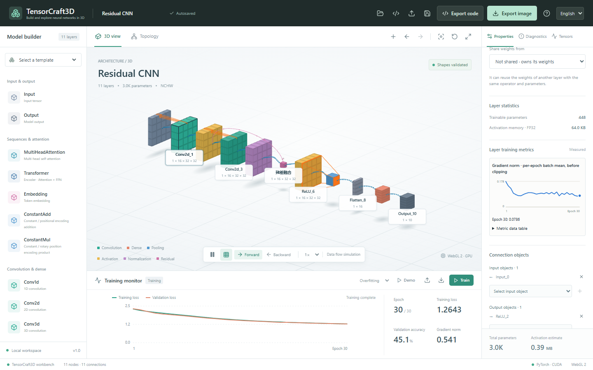
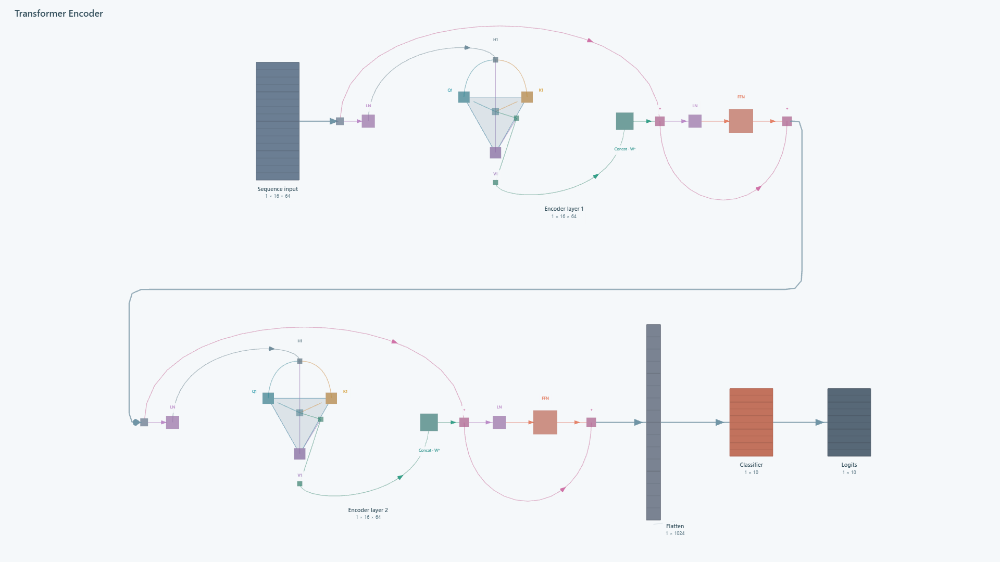
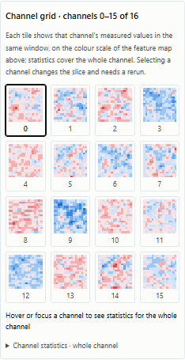

# TensorCraft3D

### Build it. Understand it. Run it.

A local **3D neural network workbench**: build visually or import PyTorch code, explore your model, run real training, then export code and diagrams. Chinese and English UI supported.

**[▶ Try the online demo](https://akiraaki114514.github.io/TensorCraft3D/)** — building, shape checks, the 3D and topology views and code/diagram export run right in the browser. Training and tensor inspection need the local Python service ([quick start](#-quick-start-windows)).

[](https://akiraaki114514.github.io/TensorCraft3D/)

## ✨ What can you do?

| Feature | What you get |
| --- | --- |
| **Build visually** | Drag in layers, wire nodes and edit parameters. See shapes and parameter counts update, with checks for invalid connections. |
| **Explore in 3D** | Explore CNNs, MLPs, residual networks and Transformers in 3D and topology views, including Attention's Q/K/V, heads and shared projections. |
| **Use your code** | Import supported PyTorch source, preview and edit its structure, then export a runnable `nn.Module`. |
| **Train for real** | Train on synthetic data or a local CSV using CPU / CUDA. Track real loss, accuracy and risk warnings, plus the selected layer's own gradient-norm curve. |
| **Inspect tensors** | Inspect tensor values, statistics and distributions with single-sample inference; read a slice as a feature map with a channel grid or as a position × feature heatmap, and view Q/K/V, scores and probabilities in Attention Inspector. Open a read-only snapshot measured by your own Python run, with the weights it trained. |
| **Save and share** | Autosave, undo/redo, project JSON import/export, plus high-resolution PNG and editable SVG diagrams. |

**Templates:** CNN · MLP · Residual CNN · Transformer Encoder · MQA · GQA · Cross-Attention. You can also start with a blank canvas.

<table>
  <tr>
    <td width="68%"></td>
    <td></td>
  </tr>
  <tr>
    <td align="center"><sub>A diagram exported from the Transformer Encoder template</sub></td>
    <td align="center"><sub>Measured feature maps, one tile per channel</sub></td>
  </tr>
</table>

## 🚀 Quick start (Windows)

Install **Node.js 20.19+** and **Python 3.10+**, then run from the project root:

```powershell
# First-time setup with training dependencies
powershell -ExecutionPolicy Bypass -File .\install.ps1 -Training

# Start and open the browser
powershell -ExecutionPolicy Bypass -File .\start.ps1
```

Opens at **http://127.0.0.1:8765**, or an available port if busy. After setup, double-click `start.cmd` to launch; close the terminal to stop.

For editing and 3D only, omit `-Training`. CUDA training needs a compatible NVIDIA driver and CUDA-enabled PyTorch. [CUDA setup](docs/workbench-guide.md#local-cuda-diagnostics-and-setup)

## 🎯 Try it in four steps

1. **Pick a template:** open Residual CNN or Transformer, rotate and zoom, then click a layer to explore.
2. **Make it yours:** add layers, edit parameters and wire nodes. Watch shapes and structure update.
3. **Run computation:** start training to track metrics, or open Tensor Inspector for single-sample inference.
4. **Take it with you:** export PyTorch code for further development, or PNG / SVG diagrams for presentations.

## Good to know

- **Animation is illustrative:** particles and weight colors are schematics; training metrics and explicitly requested tensor observations come from real PyTorch computation.
- **Structure, not weights:** source import parses supported static structures and constants, without executing uploaded code or loading original trainable weights.
- **Weights stay in memory:** only the latest successfully trained model is retained; restarting the backend clears it. Exported code and JSON do not include trained weights.
- **The online demo is static:** GitHub Pages has no Python service, so training, inference and PyTorch import only work in a local install. Projects in the demo are saved in your own browser.
- **Learning and small experiments:** training currently targets classification. Use professional tools for large models, distributed training and full profiling; warnings do not guarantee training results.

## Learn more

- [Workbench guide](docs/workbench-guide.md) — Training, CUDA, inspection, export, testing and packaging
- [PyTorch import support](docs/pytorch-import-support.md) — Syntax, limitations and diagnostics
- [Offline observation snapshots](docs/observation-snapshots.md) — Measure a sample in your own Python run and open it read-only
- [5 reproducible examples](examples/import_models/README.md) — CNN, residual, MQA, GQA and Cross-Attention

**Built with:** React · TypeScript · Three.js · React Flow · FastAPI · PyTorch
